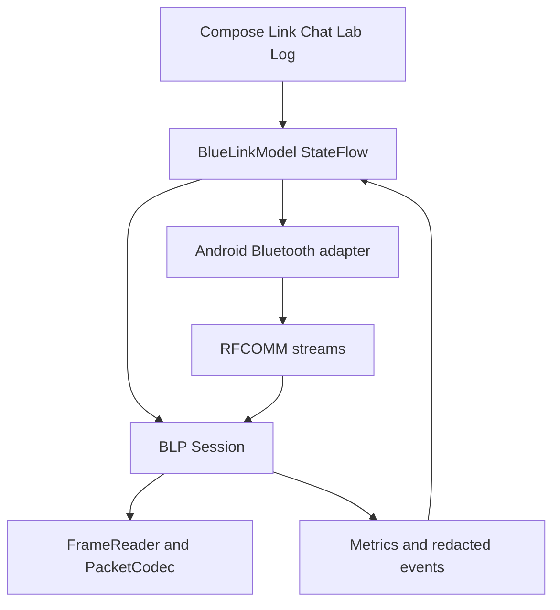
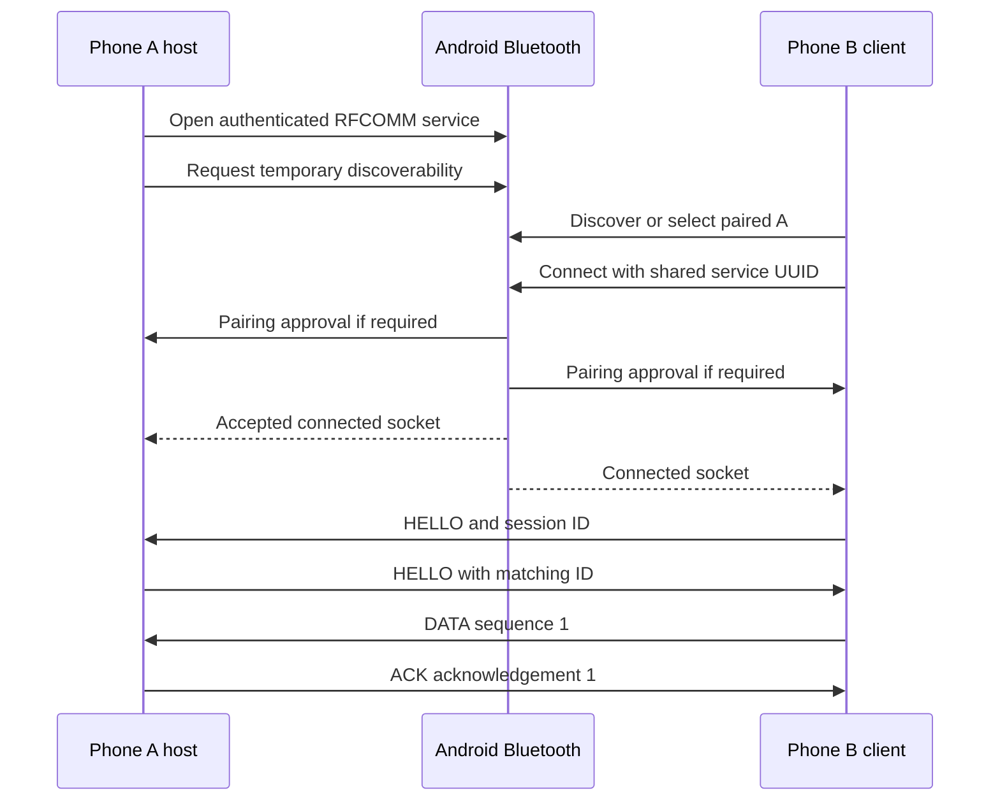
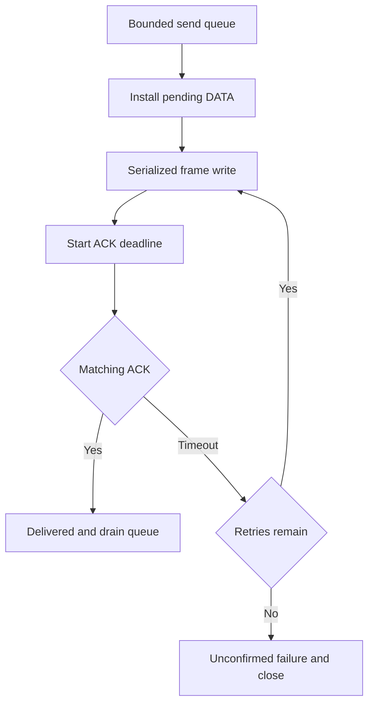
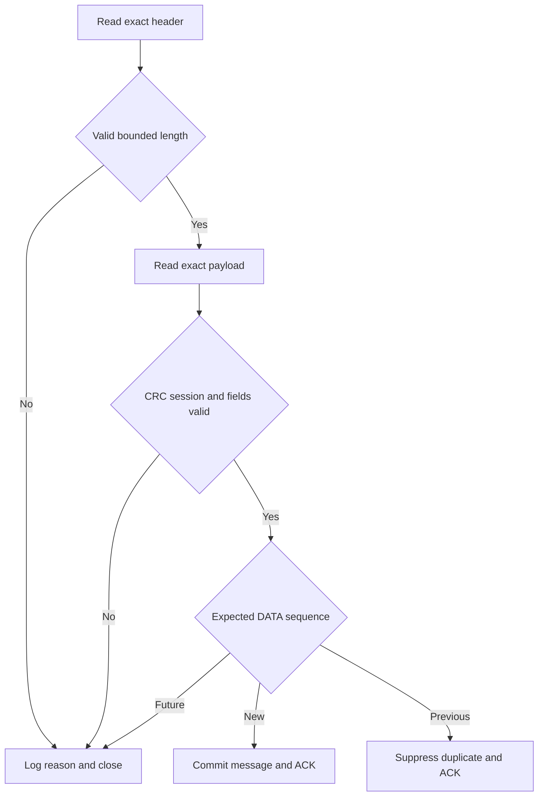
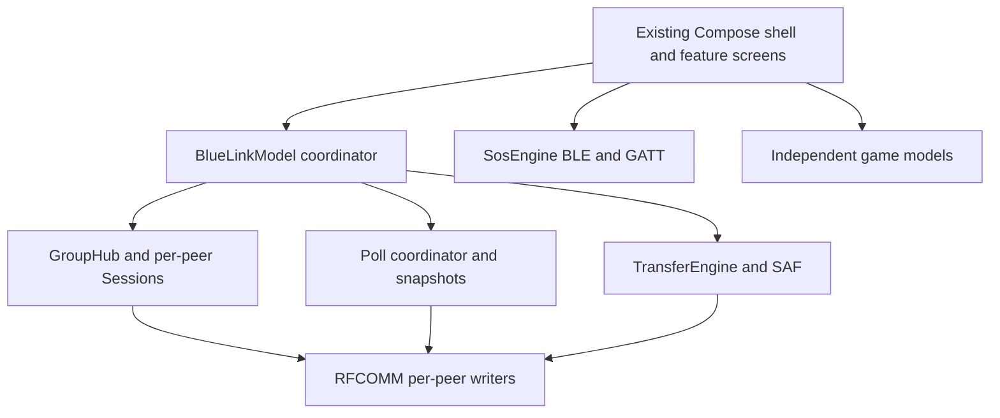

# BlueLink architecture

`MainActivity` owns Android system prompts. `BlueLinkModel` owns UI state, discovery and one connection generation. A new generation invalidates callbacks and closes stale connecting/listening sockets. `Session` owns protocol streams and three execution contexts: a reader thread, serialized writer executor and timer executor. `PacketCodec` and `FrameReader` have no Android dependency.

## Connection order

## Packet lifecycle and retransmission

ACK and PONG use the writer queue directly, without waiting on the local outbound DATA. This prevents a deadlock when both endpoints send at once. A frame is never interleaved with another frame's bytes.

## Packages and boundaries

| Path | Purpose |
|---|---|
| `app/src/main/java/dev/bluelink/MainActivity.kt` | Permission, Bluetooth enable and discoverability launchers; foreground lifecycle |
| `app/src/main/java/dev/bluelink/BlueLinkController.kt` | AndroidViewModel, immutable UI state, pairing/discovery information and socket ownership |
| `app/src/main/java/dev/bluelink/ui/BlueLinkApp.kt` | Slimecore design system and functional screens |
| `protocol/src/main/kotlin/dev/bluelink/protocol/Packet.kt` | Wire format, CRC, strict UTF-8, bounded stream framing and HELLO |
| `protocol/src/main/kotlin/dev/bluelink/protocol/Session.kt` | Handshake, reliability, queue, heartbeat, metrics and shutdown |
| `protocol/src/test/kotlin/dev/bluelink/protocol` | JVM codec, stream and duplex-session tests |

## Data and lifecycle

The view model survives Activity recreation. The app keeps at most 500 chat entries and 350 log entries. It does not persist private messages. Pending messages remain visible if Clear Conversation is selected. Closing the app foreground session cancels its connection; a system permission or discoverability flow is distinguished so that requesting visibility does not immediately cancel host mode.

Closing a transport releases the socket and unblocks I/O. Worker callbacks carry a connection generation so a cancelled connection cannot replace a later active state. Foreground service and persistent background delivery are outside this release.

## Version 2.0 composition

Per-peer sessions isolate ACK and sequence state. Feature dispatch and file work have bounded admission queues. Incoming file chunks are processed on the file worker; group upload forwarding begins after full verification. BLE lifetime, GATT clients and beacon expiry are managed independently of Classic links. Games have no dependency on network transport.
