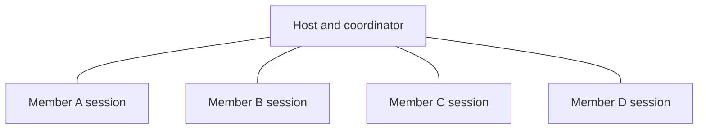

# Group communication

Create a group from Link, enter its name and description, and choose Start hosting. The app assigns a random group ID. Choose Make this phone discoverable. Other phones use Find a peer or their paired list to connect to the host. Copy joining instructions or make the host visible to invite nearby users.

The listener stays open after accepting a client. Each accepted socket has its own BLP Session, read thread, serialized writer, ACK state, sequences, timers and negotiated minor version. Capacity is host plus four peers; actual concurrent RFCOMM support must be checked on the chosen phones.

After BLP 1.1 negotiation, the host queues GROUP_CREATE with the client's assigned ID before marking that link eligible for broadcasts. This prevents a new member from receiving a group message before its group initialization. GROUP_JOIN supplies the display name; GROUP_MEMBER_UPDATE publishes the canonical member roster.

The host binds sender identity to the connection rather than trusting a sender field from a client. It validates message length and deduplicates recent application message IDs. Accepted messages are echoed to the sender and sent to other ready members. Messages include sender name and a wire timestamp, while the conversation displays local receipt time.

The host sees per-message application ACK counts. A client sees Received by host and then Relayed by host when the echo arrives. These labels do not promise that every participant has received or read the message. Host departure closes the room; automatic host migration is not implemented.

Remove a member in the Link group panel. Close a group with Disconnect. Leaving the app foreground also closes its active group. Poll and file traffic shares each session; chat and control operations are scheduled before waiting bulk file chunks. Queues and retained histories are bounded.

There is no mesh routing or direct client-to-client socket. Joining the correct paired host is an Android Bluetooth trust decision; group IDs are not passwords.
